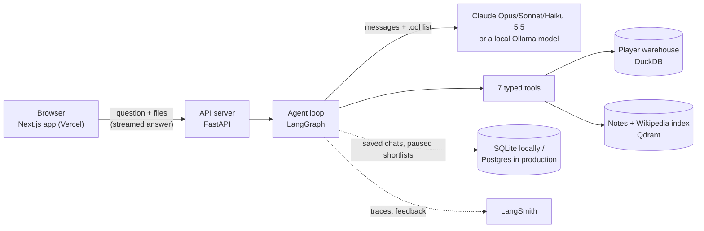
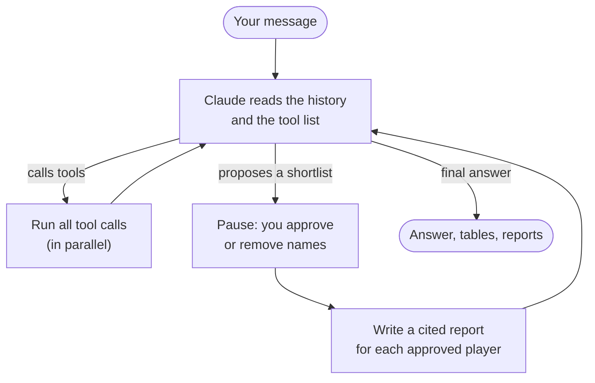

# Touchline

**An AI scouting assistant for football.** You describe the player you need in plain words, and Touchline finds candidates in a database of about 50,000 players, explains every pick with real numbers, and writes scouting reports in which every claim links to its source.

> *"A left-footed centre-back under 23, under €10M, comfortable in build-up, contract ending by 2027."*

- **Web app:** https://touchline-pi-lime.vercel.app. The interface is live, but the backend isn't deployed yet, so the site currently says it isn't connected (see [Status](#status-what-works-and-whats-missing)).
- **Project plan:** [docs/PLAN.md](docs/PLAN.md) · **Progress checklist:** [TODO.md](TODO.md)

*The name: the touchline is the line along the side of the pitch, where scouts stand and watch.*

---

## Contents

1. [What problem it solves](#what-problem-it-solves)
2. [What you can do with it](#what-you-can-do-with-it)
3. [How it works](#how-it-works)
4. [Why you can trust the answers](#why-you-can-trust-the-answers)
5. [The data](#the-data)
6. [Tech stack](#tech-stack)
7. [Project structure: which file does what](#project-structure-which-file-does-what)
8. [How it's tested and measured](#how-its-tested-and-measured)
9. [Status: what works and what's missing](#status-what-works-and-whats-missing)
10. [Limitations](#limitations)
11. [Run it yourself](#run-it-yourself)
12. [Deploying](#deploying)
13. [Data credits and licences](#data-credits-and-licences)

---

## What problem it solves

Club scouts spend most of their time on two jobs:

1. **Filtering** huge player databases for people who fit a brief (position, age, budget, contract, style).
2. **Writing reports** that justify a recommendation to the sporting director.

Professional tools (Wyscout, StatsBomb IQ, Hudl) are expensive, and their search is form-based: you tick boxes, you don't ask questions. Some clubs are moving to natural-language scouting; Sevilla FC's *Scout Advisor* and Blend360's *ScoutBot* are examples.

Touchline is a portfolio-grade version of that idea, with one rule above all: **the AI must never make anything up.** It doesn't invent numbers, players or opinions about how someone plays. The design is built around that rule (see [Why you can trust the answers](#why-you-can-trust-the-answers)).

**Who it's for:** scouts, analysts and recruitment staff, or anyone who wants to explore players by asking questions instead of filling in filters.

---

## What you can do with it

| Feature | Example | What happens |
|---|---|---|
| **Ask in plain language** | "Wingers aged 21 or under valued between €5M and €20M" | The assistant turns this into database filters and returns a ranked table |
| **Use scout vocabulary** | "Ball-playing centre-backs", "a pressing forward" | A built-in glossary maps terms like these to specific metrics (progressive passes, pressures, …) |
| **Find similar players** | "Cheaper alternatives to Florian Wirtz under €40M" | Compares playing profiles statistically and explains which traits they share |
| **Compare players** | "Compare Rodri, Declan Rice and Granit Xhaka" | Side-by-side table and a radar chart |
| **Get cited scouting reports** | "Write a scouting report on Jeremie Frimpong" | The assistant proposes a shortlist and **waits for your approval**, then writes a report where each claim about playing style links to its source passage |
| **Write scout notes** | "Great first touch, slow on the turn" | Saved notes become searchable immediately, and later reports cite them |
| **Attach files** | Screenshots, photos, PDFs, Word, Excel, CSV, video | Images and documents go to the AI as context; videos are turned into a few still frames in your browser |
| **Talk instead of typing** | Microphone button | Dictation through the browser (Chrome, Edge, Safari); answers can be read aloud |
| **Organise chats** | Folders like "Summer window" | ChatGPT-style sidebar: rename, move and delete chats and folders |
| **Edit and retry** | Fix a question you already asked | Edit any earlier question and resend it, or regenerate the last answer |
| **Pick the model** | Dropdown in the chat box | Claude Opus 5.5 (default), Sonnet 5.5, Haiku 5.5, or a local model through Ollama |

Other screens: a **player dossier** (bio, market-value chart, percentile bars, similar players, notes), **Compare**, **Shortlists**, **Notes**, and **About the data**.

---

## How it works

### In plain words

When you ask a question, the AI (Claude) doesn't answer from memory. It works like a researcher with a set of tools:

1. It reads your brief and decides what to look up, for example "search for centre-backs, left foot, age ≤ 22, value ≤ €10M".
2. It calls a **tool**: a small, strict function written in Python that queries the database. The AI fills in the tool's form; the Python code builds the actual query.
3. It reads the results, maybe calls more tools (a profile, notes search, similar players), and writes the answer using **only** what the tools returned.
4. If you asked for reports, it **pauses** with a shortlist; you tick who to write up, and each report is written from that player's data and source passages, with citations.

### The architecture



### The agent's loop



- At most **8 rounds of tool calls** per question, so a confused run can't loop forever or run up costs.
- The pause is a LangGraph `interrupt()`. The conversation is checkpointed, so you can approve a shortlist hours later, even after a server restart.
- Editing an old question doesn't rewrite history. It starts a new branch from the unchanged earlier messages, which is what Claude's reasoning blocks require.

### The tools the AI can use

| Tool | What it does |
|---|---|
| `find_player` | Turns a name ("Rodri", "Wirtz") into a database ID, with ranked candidates |
| `search_players` | Filters by position, age, value, foot, height, contract, league, nationality, minutes and **metric percentiles** |
| `get_player_profile` | Bio, contract, value history, recent seasons, per-90 metrics and percentiles |
| `similar_players` | Players with the most similar statistical profile, optionally under a price or age cap |
| `compare_players` | Side-by-side data for 2–4 players |
| `search_notes` | Searches scout notes and Wikipedia "Style of play" text |
| `propose_shortlist` | Proposes names for reports, then waits for your approval |

Every tool has a strict schema, and inputs are validated in Python before anything runs. A bad input (an age of 99, an unknown metric) goes back to the AI as an error to fix, rather than crashing or producing a bad query.

---

## Why you can trust the answers

| Risk | How Touchline handles it |
|---|---|
| The AI invents a statistic | It never writes database queries; it only calls typed tools. The system prompt allows only numbers that appear in tool results, and an automatic checker verifies every number in an answer against those results. |
| The AI invents a player | It may only name players the tools returned. A checker flags any name that isn't in the database. The target is zero. |
| The AI describes playing style from general knowledge | Style claims must come from notes or Wikipedia passages, which are passed in with **citations** turned on. In reports, cited sentences are underlined, and hovering shows the exact source text. |
| Thin data presented as solid | Every result carries a coverage badge (*market only* or *market + events*), and the prompt tells the AI to mention when stats come from a short tournament sample. |
| A query nobody can answer | Trick questions in the test set (a league that isn't covered, a player who doesn't exist, injury history) check that it says "no data" instead of guessing. |

---

## The data

| Source | What it gives | Size in Touchline |
|---|---|---|
| [Transfermarkt](https://github.com/dcaribou/transfermarkt-datasets) (open dataset) | Age, position, foot, height, club, contract, market value and its history, minutes, goals, assists | **50,149 players**, 22,292 of them active |
| [StatsBomb open data](https://github.com/statsbomb/open-data) | Every pass, carry, shot and duel in selected competitions | **297 matches** from 8 competitions, turned into 18 per-90 metrics and percentiles for **594 players** |
| [Wikipedia](https://en.wikipedia.org) | "Style of play" sections | **631 passages** from 414 player pages |
| Your scout notes | First-hand observations written in the app | Grows as you write |

**Event-data competitions:** Euro 2024, Copa América 2024, World Cup 2022, AFCON 2023, MLS 2023, and the club seasons StatsBomb released (Bundesliga 2023/24 is Leverkusen's matches; Ligue 1 2021–23 is PSG's).

**Joining the sources** was the hardest data-engineering step. StatsBomb and Transfermarkt use different IDs and spell names differently, and StatsBomb has no birth dates. Players are matched on name (nicknames preferred over legal names), nationality and club, and no Transfermarkt player can be matched twice. 87.5% of StatsBomb players are linked; Wikipedia pages are found exactly, through Wikidata's Transfermarkt-ID property.

The market data is a snapshot **dated 6 July 2026**; the upstream dataset stopped updating then.

---

## Tech stack

| Layer | Technology | Why |
|---|---|---|
| AI model | **Claude** (Opus 5.5 by default; Sonnet 5.5, Haiku 5.5) via the official Anthropic SDK; optional local models via **Ollama** | Strong tool use and native citations |
| Agent orchestration | **LangGraph** | Tool loop, human-approval pause, saved conversations |
| Monitoring and evaluation | **LangSmith** | Traces every run; holds the test dataset and experiments; collects 👍/👎 |
| Player database | **DuckDB** | Fast analytics in a single file, no server |
| Notes and passage search | **Qdrant** + **FastEmbed** (bge-small dense + BM25 keyword vectors, fused) | Hybrid search, filtered by player |
| Backend | **FastAPI**, streaming over Server-Sent Events | Live agent steps in the browser |
| Frontend | **Next.js 15** (React 19, TypeScript), plain CSS | ChatGPT-style app, no UI kit |
| App storage | SQLite locally, **Postgres** in production | Chats, folders, notes, uploads and agent threads survive restarts |
| Hosting | **Vercel** (frontend), **Render** free tier (backend, prepared); Railway config also included | |
| Tests | **pytest** (102 tests), Playwright for UI checks | |

---

## Project structure: which file does what

```
touchline/
├── data/        build the player database from the raw sources
├── agent/       the AI agent: prompts, tools, loop, models
├── rag/         notes and Wikipedia passage search
├── eval/        the 120-question test set and the scoring code
├── api/         the web server the app talks to
├── storage/     SQLite / Postgres layer for app state
├── web/         the Next.js web app
├── tests/       automated tests
├── deploy/      deployment helpers
└── docs/        the full project plan
```

### `data/`: building the player database

| File | Responsibility |
|---|---|
| `config.py` | Paths, which StatsBomb competitions to use, the 270-minute minimum |
| `download.py` | Downloads the Transfermarkt database and StatsBomb match files |
| `build_warehouse.py` | Builds `warehouse/touchline.duckdb`: players, seasons and value history; then runs the steps below |
| `statsbomb_per90.py` | Turns raw match events into per-90 metrics (xG, progressive passes, pressures, …) and position-group percentiles |
| `link_players.py` | Matches StatsBomb players to Transfermarkt players |
| `performance.py` | Picks each player's headline event profile (most recent, most minutes) |
| `wikipedia_fetch.py` | Fetches "Style of play" sections, via Wikidata, with attribution kept |
| `eval_links.py` + `labels/link_sample.csv` | Measures matching accuracy against hand-checked pairs |

### `agent/`: the AI agent

| File | Responsibility |
|---|---|
| `prompts/system.md` | The assistant's instructions: grounding rules, data coverage, the scout-language glossary, answer format |
| `prompts/report.md` | Instructions for writing a cited scouting report |
| `schemas.py` | Strict input definitions for every tool (positions, leagues, metrics, limits) |
| `tools/__init__.py` | Registry of the tools Claude sees, plus the safe dispatcher that validates and runs them |
| `tools/players.py` | `find_player`, `search_players`, `get_player_profile`, `compare_players` |
| `tools/similar.py` | `similar_players`: cosine similarity on standardised per-90 profiles |
| `tools/notes.py` | `search_notes` |
| `tools/db.py` | Read-only connection to the warehouse |
| `graph.py` | The LangGraph loop: tools, the 8-round cap, the shortlist pause, report writing |
| `claude.py` | Calls Claude: model choice, effort, prompt caching, refusal fallback, tracing |
| `models.py` | The model list and router: Claude models, plus local Ollama models with message conversion |
| `reports.py` | Writes cited reports: gathers evidence, sends passages as citable documents, maps citations back to sources |
| `messages.py` | Helpers for messages that carry attachments |
| `cost.py` | Dollar cost per model, used by the spend caps and the evaluation |
| `cli.py` | A terminal chat: `python -m agent.cli` |

### `rag/`: searching notes and Wikipedia

| File | Responsibility |
|---|---|
| `index.py` | The Qdrant index: chunking, hybrid or keyword-only search, the player filter, in-memory mode for free hosting |
| `notes.py` | Saving and listing scout notes (indexed the moment they're saved) |
| `index_notes.py` | Command line: rebuild the index, add a note, try a search |

### `eval/`: measuring quality

| File | Responsibility |
|---|---|
| `golden_spec.py` | 120 hand-written test questions: 50 searches, 20 similar-player, 25 facts, 15 reports, 10 trick questions |
| `build_golden.py` → `golden.jsonl` | Computes each question's expected answer from the database |
| `evaluators.py` | The automatic checks (see below) |
| `judge.py` | An AI judge that scores report quality from 1 to 5; it needs calibrating against human ratings first |
| `run_experiment.py`, `target.py` | Runs the test set locally or as a LangSmith experiment, with a cost cap |

### `api/`: the web server

| File | Responsibility |
|---|---|
| `main.py` | All endpoints: the streaming chat, chats and folders, uploads, models, player data, notes, feedback |
| `chats.py` | Chats, folders and saved reports, scoped to each browser |
| `files.py` | Uploads: image resizing, PDF, Word, Excel and text extraction, stored on disk or in the database |
| `limits.py` | Rate limit and daily spend caps for the public demo |

### `web/`: the app

| File | Responsibility |
|---|---|
| `components/ChatView.tsx` | The chat: messages, tool steps, results, shortlist, reports, copy, edit, regenerate, read aloud |
| `components/Composer.tsx` | The message box: attachments, drag-and-drop, paste, voice, model picker |
| `components/Rail.tsx`, `ChatsProvider.tsx` | The sidebar: new chat, pages, folders and chats with their menus |
| `components/ReportView.tsx` | Cited reports with hover cards and a source list |
| `components/Shortlist.tsx` | The approve-who-gets-a-report step |
| `components/PlayerTable.tsx`, `Charts.tsx`, `StepLog.tsx`, `PlayerPicker.tsx`, `NotesPanel.tsx` | Results tables, percentile bars, value chart, radar, step list, player search box, notes |
| `app/players/[id]`, `compare`, `shortlist`, `notes`, `about` | The other pages |
| `lib/api.ts` | Talks to the server, including reading the live stream |
| `lib/video.ts` | Extracts still frames from a video in the browser |

### Deployment files

| File | Responsibility |
|---|---|
| `Dockerfile.render`, `render.yaml` | Free Render deployment: keyword-only search, state in Postgres |
| `Dockerfile`, `railway.json`, `deploy/start.sh` | Railway deployment with a persistent volume |
| `deploy/fetch_data.py`, `deploy/data_manifest.json` | Download the built database from the [GitHub data release](https://github.com/davronbek-malikov/touchline/releases/tag/data-2026-07-06) and verify its checksums |
| `web/vercel.json` | Vercel settings for the web app |

---

## How it's tested and measured

**Automated tests (102, all passing).** They use a small fake database and a scripted stand-in for Claude, so they run in seconds without API costs. They cover:
- every tool and its input validation;
- the agent loop, the tool-round cap and the shortlist pause;
- citations and reports;
- the API, uploads and spend limits;
- Ollama message conversion;
- the real Postgres storage path, tested on an embedded Postgres server.

**The test set (120 questions)** is scored automatically:

| Check | Question it answers |
|---|---|
| Filter accuracy | Did the AI choose the right filters? |
| Precision and recall @10 | Did it return the right players? |
| Numeric grounding | Does every number in the answer appear in a tool result? |
| Invented players | Did it name anyone who isn't in the database? (target: 0) |
| Fact correctness | Are values, clubs and dates right? |
| Trick handling | Does it say "no data" instead of guessing? |
| Citation coverage | What share of style claims in reports cite a source? |
| Cost and speed | Dollars and seconds per question |

The scoring code was itself checked: perfect answers trigger zero false alarms on all 70 search questions, and a deliberately corrupted answer gets caught.

---

## Status: what works and what's missing

| Part | Status |
|---|---|
| 1 · Player database | ✅ Built |
| 2 · Tools | ✅ Built and tested |
| 3 · Agent | ✅ Built and tested (with a scripted model) |
| 4 · Test set and scoring | ✅ Built; uploaded to LangSmith |
| 5 · Notes search and cited reports | ✅ Built |
| 6 · Machine-learning models | ⏸️ **Not built.** A market-value model with explanations ("is this player undervalued?") and the TacticalDNA similarity engine were skipped for now. |
| 7 · Web app | ✅ Built, ChatGPT-style |
| 8 · Deployment | 🟡 Web app **live on Vercel**; backend **ready but not deployed** (needs a Render account and a Postgres database) |
| 9 · Experiments write-up | ⏳ Not started; needs real runs |

**Still missing:**
- **A real run against Claude.** No Anthropic API key has been added yet, so the agent has only run against a scripted stand-in. The first scored "baseline" run hasn't happened, and there are no quality numbers yet.
- **The backend deployment**, so the public site works end to end.
- **Hand checks:** the 150 player-match pairs (to measure matching accuracy) and about 30 reports rated by a person (to calibrate the AI judge).
- **A CI check** that runs the test set on GitHub before prompt changes merge.
- **Real user accounts**, if chats ever need to be shared or used across devices.
- **The value model and TacticalDNA similarity engine** (part 6).

---

## Limitations

**Data**
- **Frozen in time:** market data stops at 6 July 2026, so later transfers, contracts and values aren't known.
- **Thin event data:** detailed metrics exist for only **594 players**, mostly from short tournaments (often 300–700 minutes), not full club seasons. A style filter like "good in build-up" can only match those players; for example, no cheap young left-footed centre-back has event data.
- **Market values are Transfermarkt estimates**, not real transfer fees.
- **Player matching isn't perfect:** 87.5% of StatsBomb players are linked, and the accuracy of those links hasn't been hand-checked yet. A few known edge cases are fixed and covered by tests.
- **Wikipedia is uneven:** only 414 of about 1,200 player pages have a "Style of play" section, so for most players the only qualitative evidence is your own notes.
- **Not covered:** women's football, injuries, transfer fees, and leagues outside the dataset.

**AI**
- **Quality is unmeasured** until the first real run.
- **Similarity is simple:** cosine similarity on per-90 numbers, not the planned TacticalDNA engine.
- **Local models are weaker:** they're less reliable with tools, can't read PDFs, and reports still need Claude. Ollama support was only tested against a simulated server.
- **Video:** the AI sees about six still frames, not movement.
- **The AI judge** isn't trustworthy until it's calibrated against human ratings.

**App and hosting**
- **No logins:** chats belong to an anonymous ID stored in your browser. Clearing site data loses access, and chats don't follow you to another device. This scopes data; it isn't security.
- **Free hosting trade-offs:**
  - the Render backend sleeps after 15 idle minutes, and the first request after that takes about a minute;
  - it has 0.1 CPU;
  - notes search there is keyword-only, to fit in 512 MB.
- **Demo limits:** a few questions per minute per visitor and a small daily spend cap. The limits live in memory on one server.
- **Voice input** doesn't work in Firefox, which lacks the browser speech API.
- **Uploads:** up to 20 MB per file. Legacy `.doc` files aren't supported.
- **Licensing:** a non-commercial demo. Transfermarkt data is for non-commercial use.

---

## Run it yourself

You need Python 3.12 and Node.js 20+.

```bash
# 1. Backend environment
py -3.12 -m venv .venv                      # macOS/Linux: python3.12 -m venv .venv
.venv/Scripts/python -m pip install -e ".[dev]"
.venv/Scripts/python -m pip install -r deploy/requirements-api.txt

# 2. Data: either download the ready-made database…
.venv/Scripts/python deploy/fetch_data.py
#    …or build it from scratch (about 210 MB download, a few minutes)
.venv/Scripts/python -m data.download
.venv/Scripts/python -m data.build_warehouse
.venv/Scripts/python -m data.wikipedia_fetch
.venv/Scripts/python -m rag.index_notes

# 3. Keys: copy .env.example to .env and fill in ANTHROPIC_API_KEY (and LANGSMITH_API_KEY)

# 4. Run
.venv/Scripts/python -m uvicorn api.main:app --port 8000     # API
cd web && npm install && npm run dev                          # app on http://localhost:3000

# Or chat in the terminal
.venv/Scripts/python -m agent.cli "Ball-playing centre-backs under 25"

# Tests and evaluation
.venv/Scripts/python -m pytest
.venv/Scripts/python -m eval.run_experiment --ci --max-cost 3   # 30 questions; costs API credit
```

Keep keys in `.env` only. It's ignored by git, and a pre-commit hook blocks commits that contain keys.

---

## Deploying

**Web app (Vercel):** deploy the `web/` folder and set `NEXT_PUBLIC_API_URL` to the backend's URL.

**Backend on Render (free):**
1. Create a free Postgres database at [neon.tech](https://neon.tech) and copy its connection string.
2. In Render: **New → Blueprint →** this repository. Enter `DATABASE_URL`, `ANTHROPIC_API_KEY` and `LANGSMITH_API_KEY` when asked.
3. Set the Render URL as `NEXT_PUBLIC_API_URL` on Vercel and redeploy.

The free image uses keyword-only search and keeps all state in Postgres. In a test capped at 512 MB it peaked at about 230 MB, and data survived restarts.

**Backend on Railway (paid, about $5/month):** `Dockerfile` + `railway.json`, with a volume mounted at `/data`. This version keeps the full hybrid search.

---

## Data credits and licences

- **StatsBomb Open Data:** event data © StatsBomb, used under the [StatsBomb open data terms](https://github.com/statsbomb/open-data). The StatsBomb logo appears wherever their metrics are shown.
- **Transfermarkt**, via [transfermarkt-datasets](https://github.com/dcaribou/transfermarkt-datasets) (CC0). The data originates from Transfermarkt; non-commercial use.
- **Wikipedia** "Style of play" text, under [CC BY-SA 4.0](https://creativecommons.org/licenses/by-sa/4.0/). Each passage keeps its article URL and revision, and reports link back to them.
- The built database and passages are published as a [GitHub release](https://github.com/davronbek-malikov/touchline/releases/tag/data-2026-07-06) under the same terms.
