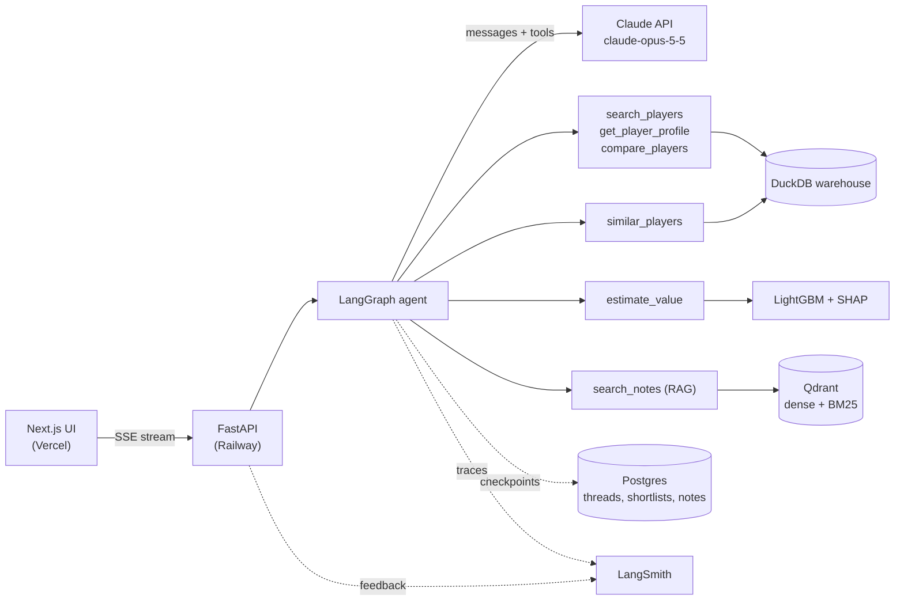
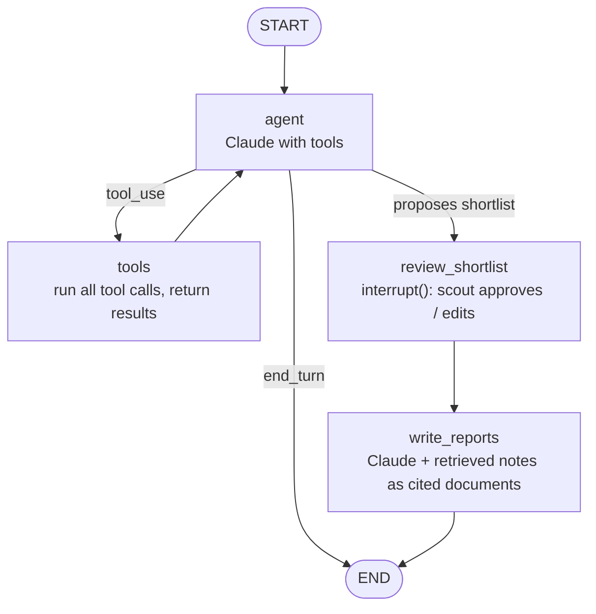

# Touchline — an AI scouting copilot for football

> *Touchline*: the line along the side of the pitch, where scouts stand and watch.
> (Working name was *Izchi*, Uzbek for "the one who follows tracks".)

**Touchline lets a football scout describe the player they need in plain language and get back a ranked, evidence-backed shortlist and scouting reports.** For example: *"a left-footed centre-back under 23, under €10M, comfortable in build-up, contract ending by 2027."* Every number in an answer comes from a database query, every qualitative claim is cited, and the whole system is measured on a fixed test set.

It is an end-to-end LLM system:

- **Claude** reasons and writes.
- **LangGraph** orchestrates a tool-using agent with human approval steps.
- **RAG** over player descriptions and the scout's own notes supplies the qualitative evidence.
- **LangSmith** traces every run and holds the evaluation experiments.
- A **Next.js UI** and a **FastAPI backend** put it in front of a user.

| | |
|---|---|
| **LLM** | Claude only: `claude-opus-5-5` through the official Anthropic Python SDK |
| **Orchestration** | LangGraph (agent loop, human-in-the-loop interrupts, persisted threads) |
| **Monitoring and evaluation** | LangSmith (tracing, datasets, experiments, online evaluators, annotation queues) |
| **Retrieval** | Qdrant hybrid search (dense + BM25), Claude native citations |
| **Data** | DuckDB warehouse built from open football data |
| **ML** | Market-value model (LightGBM + SHAP), player-similarity engine (from TacticalDNA) |
| **App** | Next.js on Vercel · FastAPI on Railway · Postgres for threads and shortlists |

---

## 1. Why this project

Scouting departments spend most of their time on two things: **filtering** huge databases for candidates, and **writing** reports that justify a recommendation. Professional tools (Wyscout, StatsBomb IQ, Hudl) are expensive, and their search is form-based.

Clubs are already moving to natural-language scouting:

- **Sevilla FC's Scout Advisor** (built with IBM watsonx and Llama 3.1) runs RAG over more than 200,000 internal scout reports. It expands vague requests with football context; for example, "talented wings" becomes dribblers who create space ([Meta](https://ai.meta.com/blog/sevilla-fc-scout-advisor-llama-ibm-watsonx/), [Sevilla FC](https://sevillafc.es/en/actual/news/scout-advisor-gen-ai-conclave-india)).
- **Blend360's ScoutBot** answers queries like "a goalscoring winger in the top quartile for progressive carries, valued below €5m" ([Blend360](https://www.blend360.com/thought-leadership/changing-the-game-how-ai-is-transforming-scouting-in-professional-football)).
- Commercial products such as **Scoutd.AI** sell club-fit scoring ([FC Business](https://fcbusiness.co.uk/news/scoutd-ai-the-intelligence-revolution-in-football-recruitment/)).

**What Touchline adds, and what makes it portfolio-grade:**

1. **Structured answers, not prose.** The LLM never makes up a number. It calls typed tools; code builds the SQL and returns rows; Claude explains them.
2. **Evidence on every claim.** Qualitative statements in reports carry Claude citations pointing to the exact passage they came from.
3. **Measured.** A golden test set of scout queries with deterministic scores (did it return the right players, are the numbers correct) plus LLM-as-judge scores for report quality. The results are tracked as LangSmith experiments.
4. **Built on my research.** It reuses my own models: the TacticalDNA archetypes and similarity engine, and a market-value model descended from my salary-prediction work (SCIE, 2025).

---

## 2. What a scout can do

| # | Feature | Example | Behind it |
|---|---|---|---|
| 1 | **Natural-language search** | "Box-to-box midfielder under 24, strong in duels, valued under €15M" | Claude → `search_players` tool with typed filters → DuckDB |
| 2 | **Find similar players** | "Cheaper alternatives to Florian Wirtz" | `similar_players` (cosine similarity on position-normalised per-90 profiles) + value filter |
| 3 | **Player dossier** | "Full report on Lamine Yamal" | `get_player_profile` + `search_notes` (RAG) → report with citations |
| 4 | **Compare** | "Compare these three left-backs" | `compare_players` → radar chart + Claude summary |
| 5 | **Undervalued finder** | "Undervalued strikers in Ligue 1" | Value model: fair value vs market value, SHAP reasons |
| 6 | **Shortlist with approval** | Agent proposes 8 names; scout approves 3 before full reports are written | LangGraph `interrupt()` + persisted thread |
| 7 | **Scout notes** | Scout writes "great first touch, slow on the turn" after a match; later searches find it | Notes embedded into Qdrant and searchable by player and topic |
| 8 | **Vague-term understanding** | "Modern full-back", "false nine", "ball-playing centre-back" | Role glossary in the system prompt maps football language to metrics |

Out of scope for v1: video analysis, live data, injury prediction, contract negotiation advice.

---

## 3. Data

| Source | What it gives | Licence / terms | Role in Touchline |
|---|---|---|---|
| **[transfermarkt-datasets](https://github.com/dcaribou/transfermarkt-datasets)** | 30,000+ players, 60,000+ games, 1.2M+ appearances, 500,000+ valuations, 175,000+ transfers, 65 competitions; one DuckDB file | Repo CC0-1.0; data originates from Transfermarkt, so credit it and stay non-commercial. **Updates paused**: current to 6 July 2026. | **Market layer:** age, position, foot, height, club, contract expiry, value history, minutes, goals, assists, cards |
| **[StatsBomb Open Data](https://github.com/statsbomb/open-data)** | Event-level data: Euro 2024, Copa América 2024, World Cup 2022, AFCON 2023, Bundesliga 2023/24 (Leverkusen), MLS 2023, Ligue 1 2021–23, La Liga 2004–21, women's competitions | Free under StatsBomb's user agreement; published work must **credit StatsBomb and show their logo** | **Performance layer:** per-90 metrics and percentiles |
| **Wikipedia** "Playing style" sections | Qualitative descriptions for well-known players | CC BY-SA 4.0: attribute, keep retrieved text under the same licence | **RAG corpus** for dossiers (cited) |
| **Scout notes** (written in the app) | First-hand observations | Yours | **RAG corpus** |
| **My own data** | Big-3 leagues 2014/15–2021/22 (salary project), TacticalDNA archetypes | Mine | Similarity engine, archetype labels, value-model baseline |

**Deliberately not used:** FBref advanced stats (Opta pulled the feed in January 2026), and direct scraping of Transfermarkt / Sofascore / WhoScored (against their terms).

**Coverage, stated honestly in the UI:** every result row shows a badge, `market only` or `market + events`.

---

## 4. Architecture



### 4.1 Agent graph



- **`agent`**: one Claude call with the tool list; loops `agent → tools → agent` with a hard cap of **8 tool rounds** per turn.
- **`review_shortlist`**: LangGraph `interrupt()`; resumes from the Postgres checkpoint, even hours later.
- **`write_reports`**: one report per approved player; notes and Wikipedia passages go in as `document` blocks with citations enabled.

### 4.2 Tools (typed, strict, testable)

The LLM never writes SQL. Each tool has a strict JSON schema; Python validates arguments and builds parameterised queries.

| Tool | Input | Output |
|---|---|---|
| `search_players` | `positions[]`, `age_min/max`, `value_max_eur`, `foot`, `contract_until_max`, `leagues[]`, `min_minutes`, `metric_filters[] {metric, percentile_min}`, `sort_by`, `limit ≤ 25` | id, name, age, club, value, coverage, requested metrics |
| `get_player_profile` | `player_id` | Bio, value history, season stats, per-90 percentiles, archetype |
| `similar_players` | `player_id`, `same_position`, `value_max_eur?`, `limit ≤ 15` | Players + similarity + top shared traits |
| `compare_players` | `player_ids[2..4]` | Side-by-side metrics (drives radar chart) |
| `estimate_value` | `player_id` | Fair value, market value, gap %, top 5 SHAP reasons |
| `search_notes` | `query`, `player_id?`, `limit ≤ 8` | Note and Wikipedia passages with source ids |

### 4.3 Claude integration rules

- `claude-opus-5-5` by default; `claude-haiku-5-5` for cheap routes only after measuring.
- No `temperature` / `top_p` / `top_k`; steer with prompt and `effort`.
- No forced `tool_choice`; `auto` + strict tools.
- Check `stop_reason` (`tool_use`, `end_turn`, `max_tokens`, `refusal`) before reading content.
- All `tool_result` blocks for one assistant turn go back in **one** user message (`is_error: true` on failures).
- State stays serialisable (`block.model_dump()`), so the Postgres checkpointer can persist it.
- System prompt + tool list cached; verify `usage.cache_read_input_tokens > 0`.
- Structured outputs for shortlist proposals; cited report text in a separate call.
- Cost guardrails: 8 tool rounds, `limit ≤ 25`, per-IP daily budget.

### 4.4 RAG design

- **Corpus:** scout notes + Wikipedia "Playing style" sections; each chunk carries `player_id`, `source`, `url`, `licence`.
- **Chunking:** one note = one chunk; Wikipedia by paragraph (~150–300 tokens).
- **Index:** Qdrant, dense `BAAI/bge-small-en-v1.5` (FastEmbed) + sparse BM25, fused with RRF, `player_id` filter in-query.
- **Generation:** passages as `document` blocks with `citations: {enabled: true}`; UI hover cards.
- **Entity linking:** StatsBomb ↔ Transfermarkt on normalised name + DOB + nationality + team; Wikipedia via Wikidata ids. Accuracy reported on 150 hand-labelled pairs.

---

## 5. Data and ML pipeline

```
raw/                          warehouse/touchline.duckdb
 ├─ transfermarkt.duckdb  ─┐   ├─ players            (TM bio, contract, value)
 ├─ statsbomb/*.json      ├──►├─ player_seasons     (TM minutes, goals, assists)
 └─ wikipedia/*.json      ─┘   ├─ sb_player_per90    (event metrics per 90, ≥ 270 min)
                               ├─ sb_percentiles     (vs same position group)
                               ├─ player_links       (SB ↔ TM ↔ Wikipedia ids)
                               ├─ player_vectors     (normalised profile for similarity)
                               └─ value_predictions  (fair value, SHAP top-5)
```

- **Per-90 metrics:** npxG, xA, shots, key passes, progressive passes and carries, passes into final third and box, successful dribbles, pressures, tackles + interceptions, aerial and ground duel win rate, pass completion under pressure. Percentiles within position group (CB, FB, DM, CM, AM, W, ST), min 270 minutes.
- **Similarity:** standardised per-90 vector per position group, cosine similarity, top shared traits as explanation.
- **Value model:** LightGBM, group k-fold by player, MAE on log value; fair − market = "undervalued" signal; SHAP top 5. It models Transfermarkt valuations, not transfer fees.

---

## 6. Evaluation

### 6.1 Golden set `eval/golden.jsonl` (≈120 queries)

| Type | Count | Gold answer |
|---|---|---|
| Filter search | 50 | Gold filter object + gold player set |
| Similar players | 20 | Gold set from the similarity engine |
| Fact questions | 25 | Exact value from the warehouse |
| Reports | 15 | Rubric + my own rating |
| Out of scope / traps | 10 | Must say "no data", must not invent a player |

### 6.2 Metrics

Filter accuracy · Precision@10 / Recall@10 · Numeric grounding · Hallucinated-player rate (target 0) · Citation coverage · Report quality (LLM judge, calibrated on 30 hand ratings) · Trap handling · Latency p50/p95, cost per query.

### 6.3 LangSmith

Tracing with `{prompt_version, effort, model}` metadata; golden set as a dataset; every prompt/tool/effort change is an experiment; online evaluators on live traces; 👍/👎 feedback → annotation queue; CI gate on PRs touching `prompts/` or `tools/` (30-query subset, fail on > 5-point drop).

### 6.4 Results table (filled in when measured)

| Experiment | Filter acc. | P@10 | Numeric grounding | Halluc. players | Report score | p50 latency | $/query |
|---|---|---|---|---|---|---|---|
| v1 baseline | — | — | — | — | — | — | — |
| + role glossary | — | — | — | — | — | — | — |
| + RAG notes | — | — | — | — | — | — | — |
| effort: high | — | — | — | — | — | — | — |

---

## 7. UI

Next.js (App Router) + TypeScript on Vercel: **Search** (chat + live agent-step timeline + result table with coverage badges), **Player dossier**, **Compare** (radar), **Shortlist board** (interrupt approvals, PDF export), **Notes**, **About / Evaluation** (architecture, data credits, live results). SSE from LangGraph `stream_mode=["messages", "updates"]`.

## 8. Deployment

Vercel (frontend) · Railway Docker (FastAPI + LangGraph, DuckDB baked in) · Qdrant Cloud free tier or embedded · Postgres (Supabase/Railway) · LangSmith projects `touchline-dev`, `touchline-prod`. Secrets: `ANTHROPIC_API_KEY`, `LANGSMITH_API_KEY`, `DATABASE_URL`, `QDRANT_URL`, `QDRANT_API_KEY`. Demo protection: per-IP rate limit, per-IP + global daily spend caps, 8 tool rounds, Anthropic console monthly limit, 6 example queries.

## 9. Repository layout

```
touchline/
├── data/            build_warehouse.py, statsbomb_per90.py, link_players.py, wikipedia_fetch.py
├── ml/              value_model.py, similarity.py, notebooks/
├── agent/           graph.py, claude.py, tools/, prompts/, schemas.py
├── rag/             index_notes.py, retriever.py
├── api/             main.py (FastAPI, SSE), auth.py, limits.py
├── web/             Next.js app
├── eval/            golden.jsonl, evaluators.py, run_experiment.py, results/
├── tests/
├── .github/workflows/  ci.yml, refresh-data.yml
└── README.md
```

## 10. Milestones

| # | Milestone | Done when |
|---|---|---|
| 1 | **Warehouse** | `touchline.duckdb` built from Transfermarkt + StatsBomb; per-90 + percentiles; linking checked on 150 pairs |
| 2 | **Tools** | Six tools, strict schemas, unit tests |
| 3 | **Agent** | LangGraph + Claude answers filter/similarity queries in terminal; traces in LangSmith |
| 4 | **Golden set + eval v1** | 120 queries, deterministic evaluators, baseline experiment |
| 5 | **RAG + reports** | Qdrant index, cited reports, shortlist `interrupt()` |
| 6 | **ML** | Value model + SHAP, similarity engine wired in, evaluated |
| 7 | **UI** | Five screens over SSE |
| 8 | **Deploy + hardening** | Public demo, limits, CI eval gate, README with GIF |
| 9 | **Experiments write-up** | Effort, glossary, RAG experiments in README |

## 11. Risks

Hallucinated players → tool-only answers + evaluator (target 0). Wrong numbers → numeric-grounding evaluator. Partial event coverage → coverage badges, metric filters refuse market-only players. Frozen TM data → "data as of" date. Licensing → StatsBomb logo + credits, non-commercial. Demo cost → caps. SB↔TM matching errors → labelled accuracy, unmatched = `market only`.

## 12. Portfolio card

```js
{
  id: "touchline",
  title: "Touchline",
  rarity: "mythic",
  cls: "Agentic RAG · LangGraph · LangSmith · Claude",
  flavor: "Describe the player you need. Get a cited, evidence-backed shortlist.",
  motif: "ml",
  stack: ["Claude API", "LangGraph", "LangSmith", "Qdrant", "DuckDB", "LightGBM", "FastAPI", "Next.js"],
  status: { state: "live", label: "LIVE DEMO" },
  links: { demo: "<vercel url>", github: "https://github.com/davronbek-malikov/touchline" },
}
```

## 13. Name

**Touchline** (chosen). English, football-native, short, and about watching from the side of the pitch, which is what scouts do.
Alternatives considered: **ThroughBall** (finding the right player for the run), **Hidden Gem** (undervalued talent), **Pathfinder** (English meaning of Izchi), **ScoutDNA** (too close to Scoutd.AI).
